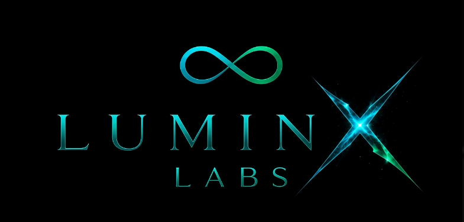

# ZBra 

_Redesigned Chess Engine._

_Written in Rust, Delivered for Strong Power and Intelligence_.

---

### Introduction

Zbra is a Chess Engine written in **Pure Rust** and made to deliver a good and clear performance. It is a hybrid: positions are scored by an [NNUE](https://chessprogramming.org/NNUE)  (ƎUИИ Efficiently Updatable Neural Networks), and the search that chooses moves is classical [minimax](https://chessprogramming.org/Minimax) with alpha-beta pruning.

## Special Thanks

Special Thanks to these project on which helped to make this project:
- [Chess Programming Wiki](https://chessprogramming.org/): Information and Guidance about Chess Programming.
- [Rust & its Community](https://rust-lang.org/): The language in which ZBra is written.
- [`bullet`](https://github.com/jw1912/bullet): The Library on which ZBra's NNUE is written.
- [Python](https://www.python.org/): The language in which the training pipeline is written.
- [`mdbook`](https://rust-lang.github.io/mdBook/): This Documetation is written in.

## About this Book

This book is dedicated for Developmental Guidance for ZBra Developers and Contributors. This book also contains some important API discussion and Architectural Information. To get started, chose your role from below and check out the guidance for it:
- Developer: Check out the [Getting Started](getting_started.md).
- Trainer: Follow [Training](training.md).
- Explorer: See [Architecture](architecture/overview).

This book will **Straight Forward** for Development giving Contributors a clear scope.

_**We are glad by seeing your interest in helping ZBra in anyway possible to you!**_

_**Luminx Labs**_

*Crafted for Infinite Brilliancy*

